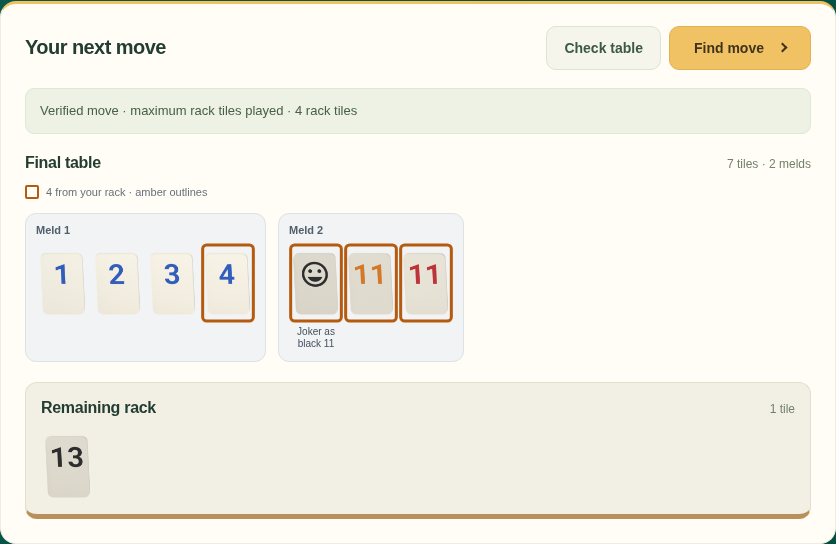
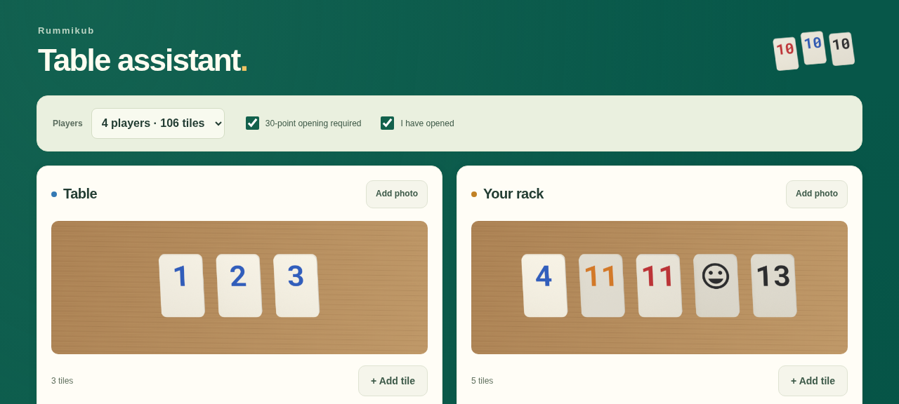

# Rummy analyzer

A Rummikub assistant that reads your table and rack, searches for a move that
plays as many rack tiles as possible, and shows the resulting table. It supports
jokers, table rearrangements, and the four-player (106 tiles) and six-player
(160 tiles) editions. Every proposed move is checked for legality.

Use the **[browser UI](https://mgaulia.github.io/rummy-analizer/)** with photos,
or the **[Go CLI](#cli)** with tile positions in JSON. Recognition and solving
run locally; photos are never uploaded to a server.



*App screenshots use generated demo tiles. They illustrate the workflow, not
real-photo recognition accuracy.*

## UI

1. **[Open the app](https://mgaulia.github.io/rummy-analizer/)** in Safari on your
   iPhone or a desktop browser. Allow the local reader and solver to load.
2. Under **Table**, choose **Add photo** for the existing melds. Under **Your
   rack**, add a separate photo of your tiles.
3. Review the readings. Readable tiles work immediately, without confirmation.
   Edit any wrong color or number; for the table, check the **Meld** and **Order**
   fields. Use **×** to remove a false detection and **+ Add tile** for a miss.
   Unreadable or invalid entries show an error and must be corrected before solving.
4. Keep **4 players**, or choose the six-player edition. **30-point opening
   required** is on by default. Select **I have opened** if you opened on an
   earlier turn, or turn the opening rule off to skip that phase.
5. Choose **Find move**. Amber outlines mark tiles played from your rack; joker
   captions show their assigned roles. **Remaining rack** shows what stays in
   your hand. **Check table** validates the current layout without finding a move.



Take clear, upright photos with all tiles visible. Readings can be wrong, so
check them against the images. A verified move is legal; if the result says
**search incomplete**, a better move may still exist. An incomplete search does
not prove that no legal move exists.

After the initial download, reading and search use the bundled local code and
model. Refreshing clears the session; offline reopening is not currently
supported. **Reading report → Save report** downloads a diagnostic file containing
your photos and readings. It stays local unless you choose to share it.

## CLI

Install a [supported Go release](https://go.dev/dl/) and clone the repository:

```sh
git clone https://github.com/MGaulia/rummy-analizer.git
cd rummy-analizer
```

Run the included example, with the player already past the opening phase:

```sh
# Check the table and known tile inventory.
go run . validate --edition=4 < testdata/positions/rearrangement.json

# Find a move and print the result as JSON.
go run . solve --edition=4 --opened < testdata/positions/rearrangement.json

# Save the final table as a standalone SVG image.
go run . solve --edition=4 --opened --format=svg \
  < testdata/positions/rearrangement.json > final-table.svg
```

This example plays all four rack tiles. For your own position, follow the
[example JSON](testdata/positions/rearrangement.json): `table` contains an array
of melds, `rack` contains your tiles, and each physical tile has a unique `id`.
Numbered tiles use `{"color":"blue","number":3}`; a joker uses `{"joker":true}`.
Colors are `black`, `blue`, `orange`, and `red`; numbers run from 1 to 13.

Position commands require **`--edition=4` or `--edition=6`**. The 30-point opening
is required by default. **`--opened`** records that you opened on a previous turn;
**`--opening-required=false`** skips opening restrictions entirely.

JSON results distinguish `optimal` (maximum proved), `feasible_incomplete`
(a legal move, possibly improvable), `no_move` (absence proved), and `incomplete`
(no verified move found; the search was not conclusive). When a verified move is
found, results include played tile IDs, the final table, remaining rack, and an
SVG diagram. Search limits and some
joker transitions can leave a result incomplete; see the [rule coverage](docs/rules.md).

To check whether a single collection can form a meld, use the text interface:

```sh
printf 'blue 3\nblue 1\nblue 2\n' | go run .
```

It reports `Can form group/run: true`. Interactive `go run .` accepts one tile
per line, including `joker`, up to 13 tiles. Use `go run . -h` for command help.

Developer references: [checks](docs/development.md), [architecture](docs/architecture.md),
[product scope](docs/product-spec.md), and [implementation status](docs/implementation-plan.md).
Tile artwork: [KlaasYK's Printables model, CC BY-SA 4.0](docs/tile-art.md).
